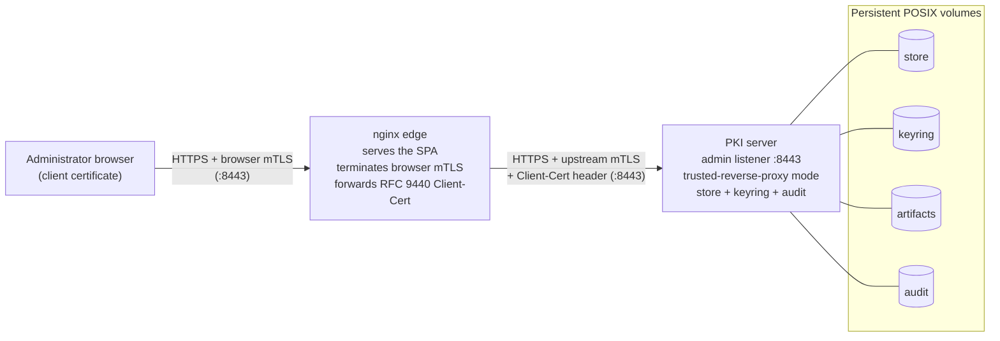

# Deployment Guide

This guide explains how to run the ZeroEcho PKI platform as a pair of containers: an
administrative API server that owns the certificate-authority state, and an nginx
edge that serves the web console and terminates browser mutual-TLS. It covers the
host prerequisites, the two container images, the data and configuration contract,
a Kubernetes deployment, day-two operations, and the security model you must
uphold at the edge.

## What you will deploy

The platform runs as two cooperating containers on a private network:

- **The PKI server** — a long-lived HTTPS service that holds the system of record:
  certificate authorities, requests, issued credentials, revocations, the metadata
  log, and the CA signing keyring. It exposes only a JSON API (administrative,
  public, and health routes) over a mandatory mutual-TLS listener. It does not
  serve any static web content.
- **The nginx edge** — a stateless reverse proxy that serves the single-page web
  console bundle, terminates the administrator's browser client certificate, and
  forwards the verified client identity to the PKI server over its own mutual-TLS
  connection.

Administrators authenticate exclusively with an X.509 client certificate presented
by their browser. There is no password or anonymous access path to the console.

## The two-container topology

The browser presents an administrator client certificate to nginx. nginx verifies
that certificate against the administrators' trust bundle, then forwards the
verified leaf to the PKI server as an [RFC 9440](https://www.rfc-editor.org/rfc/rfc9440)
`Client-Cert` header while authenticating upstream with its own transport client
certificate. The PKI server runs in trusted-reverse-proxy mode and independently
validates both identities before it maps the forwarded certificate to a persisted
administrative principal.

Only the nginx container is published to the host or cluster network. The PKI
server's admin listener is reachable solely from within the private network shared
by the two containers.

!!! note "Why the identity is verified twice"
    nginx terminating the client certificate is a convenience, not a trust
    boundary the server relies on blindly. The PKI server re-validates the
    forwarded leaf against its own administrative client trust and requires the
    edge itself to present a trusted transport certificate. Neither container can
    be impersonated without possession of a private key trusted by the other.

## How the guide is organised

| Page | What it covers |
|---|---|
| [Requirements](requirements.md) | Host, filesystem, and container-runtime prerequisites; POSIX guarantees the store and keyring depend on. |
| [Container images](containers.md) | The two images, how to build or obtain them, and running the reference Compose stack. |
| [Configuration](configuration.md) | The volume and environment contract: the store, keyring, artifacts, audit, config mounts, and secrets. |
| [Kubernetes](kubernetes.md) | A StatefulSet with per-instance volumes, ConfigMaps, Secrets, Services, and probes. |
| [Operations](operations.md) | Health endpoints, backup and restore, upgrades, disaster recovery, and log handling. |
| [Security hardening](security-hardening.md) | The mutual-TLS trust model, header-spoofing defences, response headers, and secret hygiene. |

If you are new to the platform's concepts, read the
[architecture overview](../overview/architecture.md) first. Once the stack is
running, the [Administrator Guide](../admin/console.md) explains how to use the
console.
