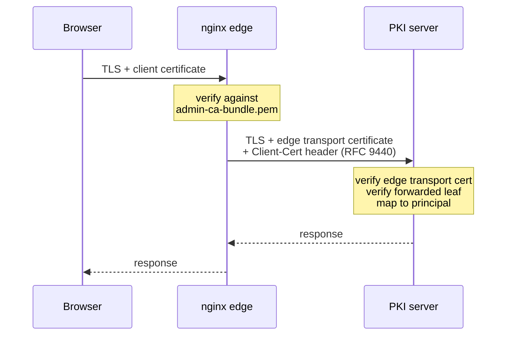

# Security hardening

The platform's security rests on a chained mutual-TLS trust model, strict handling
of the forwarded client identity, hardened response headers at the web origin, and
least-privilege containers. This page explains each control and what you must do to
keep it sound. For the underlying authorization model, see the
[security model reference](../reference/security-model.md).

## The mutual-TLS trust model

Three TLS relationships chain from the browser to the server, and each is verified
independently.



- **Browser to nginx.** nginx completes the handshake only if the browser's client
  certificate chains to the administrators' CA bundle
  (`ssl_verify_client on`, `ssl_verify_depth 3`). There is no password or anonymous
  path.
- **nginx to server.** nginx authenticates to the server with its own transport
  client certificate. The server admits it only if it matches the trusted-proxy
  mapping in its configuration.
- **Server-side re-verification.** The server independently validates the forwarded
  administrator leaf against its `administrativeClientTrust`, then maps it to a
  persisted principal by an exact commitment (a SHA-256 over the certificate, the
  subject public key info, or the issuer and serial). A mapping establishes
  identity only; authority comes from scoped grants on that principal. See
  [Access control](../admin/access-control.md).

!!! note "Keep the two trust anchors aligned"
    The edge's browser-mTLS bundle (`admin-ca-bundle.pem`) and the server's
    `administrativeClientTrust` must share the same administrator trust anchors. If
    they drift, a certificate the edge accepts may be rejected by the server, or
    the reverse.

## Forwarded client certificate and preventing header spoofing

nginx forwards the verified browser leaf to the server as an
[RFC 9440](https://www.rfc-editor.org/rfc/rfc9440) `Client-Cert` header, whose
value is a Structured-Fields Byte Sequence: a colon, the base64 of the DER
certificate, and a closing colon. The bundled njs helper produces exactly this form
from the certificate nginx verified during the handshake, so the value the server
parses is derived from a real, verified certificate — not from anything the client
could set.

The critical hardening is that a client must never be able to inject its own
forwarded-identity header. The edge strips any inbound identity headers before
proxying by setting them to an empty value, which makes nginx drop the field
entirely:

```nginx
# Forward only the certificate nginx itself verified.
proxy_set_header Client-Cert $rfc9440_client_cert;

# Strip anything a client might have sent, so it never reaches the server.
proxy_set_header Client-Cert-Chain      "";
proxy_set_header X-ZeroEcho-Client-Cert "";
```

!!! warning "Never expose the server's admin listener directly"
    The server trusts the forwarded `Client-Cert` header **because** it trusts the
    proxy that sent it — proven by the proxy's own transport certificate. If the
    admin listener were reachable from the network directly, a caller presenting a
    trusted transport certificate could assert any forwarded identity. Publish only
    the edge; keep the admin listener on the private network. If you place an
    Ingress in front of nginx, it must pass browser mutual-TLS through rather than
    terminating it.

The edge also caps request bodies at the origin (admin API bodies are small JSON
documents), and the server independently bounds header, body, and
forwarded-certificate sizes in its configuration.

## Response headers at the web origin

nginx sets strict security headers on every response from the console origin, and
re-emits them on the app shell so nested locations do not lose them.

- **Content-Security-Policy.** `default-src 'none'` with `connect-src 'self'` keeps
  all fetches same-origin — the console calls only same-origin API prefixes.
  `script-src 'self'` (no `'unsafe-inline'`) is safe because the console build
  emits only hashed, external module scripts and no inline `<script>`.
  `style-src 'self' 'unsafe-inline'` is the one deliberate relaxation: the UI
  toolkit injects component styles at runtime through the CSSOM. Style injection
  cannot exfiltrate data or execute code the way script can, so this is a
  well-understood, low residual risk. If your policy forbids it, the stricter
  alternative is a per-response nonce (`style-src 'self' 'nonce-<random>'`) with a
  matching insertion point and nonce configured in the UI toolkit's style cache,
  at the cost of generating and injecting a nonce per request at the edge.
- **Strict-Transport-Security.** `max-age=63072000; includeSubDomains; preload`
  enforces HTTPS at the origin. The edge also redirects plain HTTP to HTTPS as
  defence in depth.
- **Clickjacking and framing.** `frame-ancestors 'none'` plus `X-Frame-Options:
  DENY` block framing entirely.
- **Additional headers.** `X-Content-Type-Options: nosniff`,
  `Referrer-Policy: no-referrer`, a restrictive `Permissions-Policy`, and
  cross-origin opener and resource policies of `same-origin`.

TLS at the edge is limited to TLS 1.3 and TLS 1.2 with a high-strength cipher suite.

## Least-privilege containers

Both images run without unnecessary privilege.

- **Non-root runtime for the server.** The server image runs as the unprivileged
  `zeroecho` user (uid/gid `10001`). On Kubernetes the pod adds
  `runAsNonRoot: true`, `allowPrivilegeEscalation: false`,
  `readOnlyRootFilesystem: true`, and drops all Linux capabilities; only the
  declared data volumes and a `/tmp` `emptyDir` are writable.
- **nginx.** The nginx master starts as root only to bind its ports and read the
  TLS keys, then drops to the unprivileged `nginx` user for its worker processes,
  as with the stock image.
- **Stable numeric identity.** The fixed uid/gid lets Kubernetes `runAsUser` and
  `fsGroup`, and host bind-mount ownership, align to the same user without guessing.

## Network segmentation

- Publish **only** the nginx edge to the host or cluster network. In Compose the
  server's port is documentation-only (`expose`, not `ports`); on Kubernetes its
  Service is headless and internal.
- Keep the two containers on a private network so the admin listener is reachable
  solely from the edge. On Kubernetes, consider a NetworkPolicy that admits traffic
  to the server's port only from the edge pods.
- Terminate browser mutual-TLS at the edge and nowhere else, so the forwarded
  identity always originates from a verified handshake.

## Secret hygiene

- **Passwords only through the environment.** The keyring unlock password and the
  PKCS#12 store passwords reach the server only as environment variables named in
  the configuration; the configuration file itself holds no secret values. Never
  bake a secret into an image or commit a filled-in environment file.
- **Separate the keyring from the store.** Keep the keyring on its own,
  more strictly controlled volume, with its backups and its unlock password held
  separately from the store, so no single compromise yields both the state and the
  keys.
- **Restrict the health-probe identity.** The probe's client key is mounted
  read-only with a restrictive mode. Scope its certificate so it can pass the
  handshake for the health routes and nothing more.
- **Rotate deliberately.** Rotating the edge's browser-trust bundle, the
  administrators' trust, the transport certificates, or the keyring password are
  configuration and mount changes — apply them without rebuilding images, and
  re-validate the configuration before restarting.

Return to [Configuration](configuration.md) for the mounts and variables these
controls depend on, or to [Operations](operations.md) for backup and recovery.
