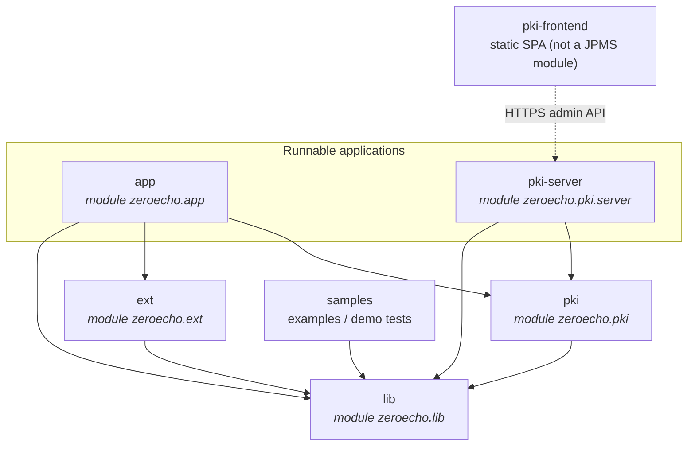

# Modules

ZeroEcho PKI is built as a small set of Java modules with a strict, one-way
dependency direction, plus a browser front-end that is a static single-page
application rather than a Java module. Every Java artifact is a Java Platform
Module System (JPMS) module with an explicit `module-info.java`; the front-end
is a TypeScript/Vite bundle served as static files.

The design goal is separation of concerns: foundational cryptography and the
PKIX API live at the bottom, the PKI domain sits above them, and the runnable
server and command-line applications sit at the top. Cross-cutting backends
(persistence, signing, publication, the cryptographic provider) are reached only
through service-provider interfaces, never through direct dependencies on a
concrete implementation.

## Dependency direction



Dependencies point downward only. `lib` depends on nothing else in the platform.
Both `pki` and `ext` `requires transitive zeroecho.lib`, so a consumer of `pki`
automatically reads the `lib` API. The applications sit at the top and are read
by nothing.

## Module map

| Module | JPMS name | Responsibility | Depends on | Notable exports |
| --- | --- | --- | --- | --- |
| `lib` | `zeroecho.lib` | Cryptographic core, the `zeroecho.pkix` PKIX API, the encrypted keyring, and core SPIs. The concrete cryptographic toolkit is confined here behind a service seam. | (platform: nothing) | `zeroecho.pkix`, `zeroecho.pkix.cert`/`csr`/`crl`/`ocsp`/`sign`/`spi`, `zeroecho.core.storage`, `zeroecho.core.spi`, `zeroecho.sdk*` |
| `ext` | `zeroecho.ext` | Supporting utilities — content export and covert/steganographic integrations. Not on the PKI issuance path. | `zeroecho.lib` (transitive) | `zeroecho.ext.integrations.covert.jpeg` |
| `pki` | `zeroecho.pki` | The PKI domain and application layer (authorities, profiles, issuance, revocation, status, publication), the extension-point SPIs, and the default filesystem persistence and signing backends. | `zeroecho.lib` (transitive) | `zeroecho.pki.api.*`, `zeroecho.pki.application`, `zeroecho.pki.spi`, `zeroecho.pki.spi.store`/`crypto`/`publish`/`audit` |
| `pki-server` | `zeroecho.pki.server` | The long-lived HTTPS server and administrative JSON API over the PKI domain, plus exported ACME, TLS/trust and CT extension contracts. | `zeroecho.pki` (transitive), `zeroecho.lib` | `zeroecho.pki.server.spi.v2`, `zeroecho.pki.server.ct` |
| `app` | `zeroecho.app` | The single-process `zeroecho` command-line application, including the `zeroecho pki` utility. Runnable; exposes no API. | `zeroecho.lib`, `zeroecho.ext`, `zeroecho.pki` | (none — terminal application) |
| `pki-frontend` | *(not a JPMS module)* | The administrator web console: a descriptor-driven single-page application over the `pki-server` admin API. React + MUI, built with Vite/TypeScript, shipped as static assets. | `pki-server` admin API (over HTTPS) | (static bundle) |
| `samples` | *(test-only)* | Runnable examples and demonstration tests that exercise the public API. | `zeroecho.lib` | (examples) |

## What each module exposes

### `lib` — `module zeroecho.lib`

`lib` is the only module that reads the concrete cryptographic toolkit, and it
does so with non-transitive `requires` so the dependency does not leak. It
exports the cryptographic core (`zeroecho.core.*`), the high-level SDK
(`zeroecho.sdk.*`), the encrypted keyring (`zeroecho.core.storage`), and the
PKIX API packages:

```java
exports zeroecho.pkix;
exports zeroecho.pkix.cert;
exports zeroecho.pkix.crl;
exports zeroecho.pkix.csr;
exports zeroecho.pkix.ocsp;
exports zeroecho.pkix.sign;
exports zeroecho.pkix.spi;

uses zeroecho.pkix.spi.PkixProvider;                 // (1)
uses zeroecho.core.CryptoAlgorithm;
uses zeroecho.core.spi.AlgorithmExecutionCapabilityProvider;
```

1. The PKIX facade resolves its provider through `ServiceLoader`; the built-in
   implementation is the fallback. See [Extending the platform](extending.md).

The `zeroecho.pkix.bc` implementation package is deliberately **not** exported —
it is an internal detail of `lib`.

### `pki` — `module zeroecho.pki`

`pki` `requires transitive zeroecho.lib` and exports both the domain API
(`zeroecho.pki.api.*`, `zeroecho.pki.application`) and the extension-point SPIs.
It both `uses` and `provides` the backend service types, wiring the default
filesystem and signing implementations while leaving them replaceable:

```java
uses zeroecho.pki.spi.store.PkiStoreProvider;
uses zeroecho.pki.spi.crypto.SignatureWorkflowProvider;
uses zeroecho.pki.spi.publish.PublisherProvider;
uses zeroecho.pki.spi.audit.AuditSinkProvider;
uses zeroecho.pki.spi.algorithm.X509AlgorithmBindingProvider;

provides zeroecho.pki.spi.store.PkiStoreProvider
        with zeroecho.pki.impl.fs.FilesystemPkiStoreProvider;
provides zeroecho.pki.spi.crypto.SignatureWorkflowProvider
        with zeroecho.pki.impl.crypto.zeroecholib.ZeroEchoLibSignatureWorkflowProvider;
```

The default backend implementation packages (`zeroecho.pki.impl.*`) are exported
only to the sibling application modules that must construct them
(`exports ... to zeroecho.pki.server, zeroecho.app`), not to the world.

### `pki-server` — `module zeroecho.pki.server`

`pki-server` `requires transitive zeroecho.pki` and adds the JDK HTTP server and
naming stack. It exports `zeroecho.pki.server.spi.v2` for explicitly configured
ACME challenge, EAB, TLS and trust providers, and `zeroecho.pki.server.ct` for CT
client composition. Legacy classpath providers remain supported through internal
adapters. Server implementation and authentication packages stay unexported.

### `app` — `module zeroecho.app`

`app` reads `zeroecho.lib`, `zeroecho.ext`, and `zeroecho.pki`, plus a small
command-line parsing library. It is terminal and exports no packages.

!!! info "Cryptographic provider confinement"

    The underlying cryptographic toolkit is an implementation detail of `lib`.
    It is pulled in with non-transitive `requires` and only the internal
    `zeroecho.pkix.bc` package uses it directly; that package is not exported.
    Code in `pki`, `pki-server`, `ext`, and `app` therefore programs against the
    JCA-aligned `zeroecho.pkix` API and standard `java.security` types, and never
    depends on the toolkit directly. A replacement provider can be dropped in
    without recompiling anything above `lib` — see
    [Extending the platform](extending.md#the-cryptographic-provider-seam).
