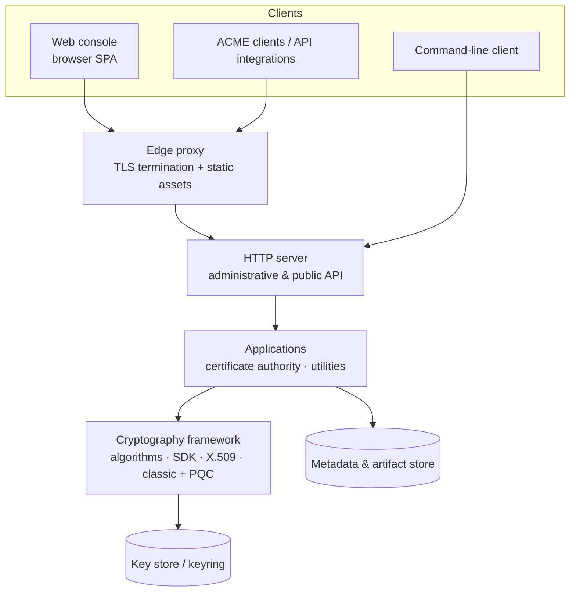
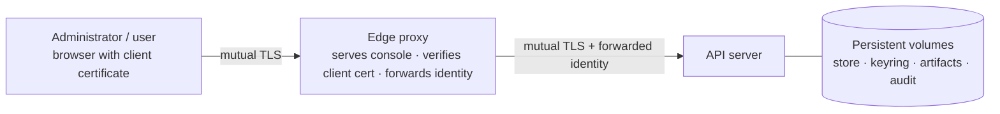

# Architecture

ZeroEcho is a small set of Java modules plus a decoupled web console. The
cryptography **framework** (the library) sits at the foundation; **applications**
are built on it. The certificate authority is the flagship application — exposed
through an HTTP server, a command‑line client, and a browser console — and
smaller utilities (such as data hiding and content protection) sit on the same
foundation as peers.

## Building blocks

- **Cryptography framework** — the general‑purpose foundation: algorithm
  discovery, key generation, signing and verification, key establishment, content
  protection, and building and parsing X.509 objects, across classic and
  post‑quantum algorithms. It also provides the keyring for protecting private
  keys. It is usable on its own and carries every application below.
- **Applications** — domain logic layered on the framework. The certificate
  authority is the flagship (authorities, profiles, requests, issuance,
  revocation and status objects, publication, and durable persistence); smaller
  utilities are peers. Applications depend on the framework, not the reverse.
- **HTTP server** — exposes the administrative API (mutual‑TLS, JSON), the public
  repository, and the ACME and OCSP endpoints. It contains no business logic of
  its own beyond transport, authentication, and authorization.
- **Command‑line client** — runs operations either in‑process against a local
  store or remotely against a running server over mutual TLS.
- **Web console** — a static single‑page application served at the edge. It calls
  the same HTTP API and holds no secrets.

For the full module map and dependency directions, see
[Modules](../developer/modules.md).

## Deployment topology

A typical deployment runs two containers: an edge proxy that serves the console
and terminates the browser's client certificate, and the API server.

The browser authenticates to the edge proxy with a client certificate; the proxy
serves the console, applies the web‑origin security headers, and forwards the
verified client identity to the API server, which authorizes every request. The
server keeps no session state. See the [Deployment guide](../deployment/index.md)
for the full contract.

## State at rest

The server persists everything to a POSIX filesystem:

| State | Purpose |
|---|---|
| Metadata & artifact store | Authorities, profiles, requests, credentials, status objects, publication records, and the signing ledger |
| Keyring | Protected private keys for the authorities (kept separate from the store) |
| Published artifacts | Certificates and CRLs made available through the public repository |
| Audit sink | The cryptographically chained audit trail |

These are mapped to persistent volumes in a deployment so that data survives
restarts and upgrades. Storage and signing are service‑provider seams, so an
alternative backend or an external signer can be plugged in without changing the
domain logic — see [Extending the platform](../developer/extending.md).

## Trust and authorization

Authentication is per‑request mutual TLS. Authorization is role‑based: principals
hold grants that permit specific actions on specific resources within a scope,
high‑risk actions can require an approval by a separate principal, and emergency
access is possible through auditable break‑glass grants. The
[Security model](../reference/security-model.md) describes this in full.
