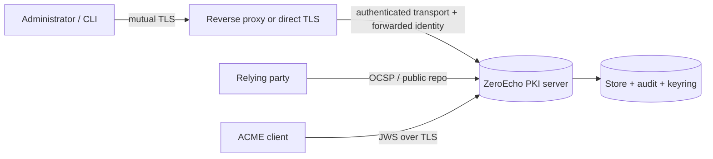
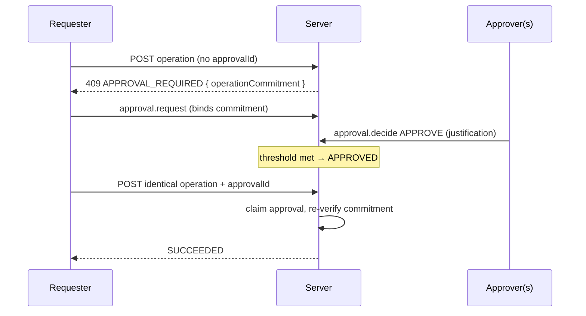

# Security model

ZeroEcho PKI is built around a single, uncompromising principle: **the server
authorizes every request on its own merits.** There are no trusted clients, no
sessions, and no user interface that can grant access the server would otherwise
refuse. This page describes the trust boundaries, the authentication and
authorization mechanisms, the dual-control and break-glass workflows, the audit
trail, and the data-view redaction levels that together enforce least privilege.

It is a companion to the [administrative API](admin-api.md) (which carries these
requests), the [configuration reference](configuration-reference.md) (which
defines authentication and disclosure defaults), and the
[CLI reference](cli-reference.md).

## Trust boundaries

The server sits at the center of a small number of explicit boundaries:

- **Client ⇄ server.** Every administrative connection presents a client
  certificate. In `DIRECT_MTLS` the server maps the TLS peer directly. In
  `TRUSTED_REVERSE_PROXY` an independently authenticated proxy terminates the
  client TLS and forwards the validated client certificate; the proxy's own
  transport certificate must belong to the explicitly trusted-proxy principal
  set, and proxy and end-client identities can never overlap.
- **Server ⇄ store, audit, and keyring.** Secrets (keyring unlock, TLS store
  passwords) are supplied only as environment-variable **names** in
  configuration; the process reads the values at startup. The configuration file
  itself holds no secrets.
- **Relying parties.** OCSP and the public repository are served on a separate,
  read-only listener with its own bounds and its own optional-client
  authentication.

## Per-request authentication — no cookies, no sessions

There is no login endpoint, no session cookie, and no bearer token that stands in
for a user. Authentication happens on **every** request from the client
certificate:

1. The TLS peer (or the forwarded client certificate) is matched against the
   configured client-certificate mappings by a cryptographic commitment —
   certificate SHA-256, subject-public-key-info SHA-256, or issuer-and-serial
   SHA-256. All present commitments must match.
2. A match resolves to a **server principal**. No match is a hard
   `401` authentication failure.
3. In `DIRECT_MTLS` mode, a request that carries a forwarded-identity header is
   refused outright (`400`), because only a trusted proxy may forward identity.

Because identity is re-established per request, revoking or disabling a principal
takes effect immediately — there is no session to expire.

## Role-based access control

Every authenticated request is evaluated by a deterministic, side-effect-free,
**default-deny** authorization engine before any work is done. The engine reads
an immutable snapshot of the principal's grants for that single decision; it never
calls out to external code. **Explicit deny always wins** over any allow.

### Principals, roles, and grants

- A **principal** is a stable server identity (an administrator, a service, a
  proxy). Principals can be enabled or disabled.
- A **role assignment** binds a principal to a role template within a scope,
  optionally with an expiry. Role templates package grants for common duties.
- A **grant** is the atomic unit of authorization. Each grant is an immutable,
  scoped tuple:

| Grant field | Meaning |
| --- | --- |
| `effect` | `ALLOW` or `DENY` (deny takes precedence). |
| `action` | The exact permitted action (see the action vocabulary below). |
| `resourceType` | The kind of resource the action applies to. |
| `scope` | Realm, and optional authority, issuer, profile, and OCSP-responder dimensions. |
| `relationship` | `OWN` (only objects the principal owns) or `ANY`. |
| `dataView` | The maximum [data view](#data-view-redaction) the grant confers. |
| `conditions` | Zero or more closed conditions (see below). |
| `expiresAt` | Optional mandatory upper bound for a temporary grant. |
| `enabled` | Whether the grant participates in decisions. |

### Decision outcomes

The engine returns one safe decision code that never discloses the existence of a
protected object:

`ALLOWED`, `NO_MATCHING_GRANT`, `EXPLICITLY_DENIED`, `OUTSIDE_REALM`,
`OUTSIDE_AUTHORITY_SCOPE`, `INSUFFICIENT_DATA_VIEW`, `APPROVAL_REQUIRED`,
`GRANT_EXPIRED`, `PRINCIPAL_DISABLED`, `CONDITION_NOT_SATISFIED`.

### Action vocabulary

Actions are semantically separated so that a grant confers exactly one capability
and no more — reading metadata does not imply reading content or PII, and issuing
does not imply revoking. The vocabulary is a closed, stable set grouped by domain:

| Domain | Representative actions |
| --- | --- |
| Realm & server | `REALM_READ`, `SERVER_CONFIGURATION_READ/UPDATE`, `FORWARD_AUTHENTICATED_CLIENT_IDENTITY` |
| Identity & RBAC | `PRINCIPAL_MANAGE`, `ROLE_MANAGE`, `PERMISSION_GRANT` |
| Authorities & issuers | `AUTHORITY_LIST/READ/CREATE/…`, `ISSUER_CREATE/ROTATE/RETIRE`, `CA_CHAIN_DOWNLOAD` |
| Profiles & policy | `PROFILE_READ/REGISTER/VALIDATE/ACTIVATE/DEACTIVATE`, `POLICY_READ/UPDATE`, `X509_BINDING_READ` |
| Requests | `REQUEST_SUBMIT`, `REQUEST_READ_OWN/ANY`, `REQUEST_APPROVE/REJECT/CANCEL` |
| Certificates | `CERTIFICATE_ISSUE/RENEW/REKEY`, `CERTIFICATE_READ_METADATA/CONTENT/PII`, `CERTIFICATE_REVOKE/HOLD/RELEASE_HOLD`, `CERTIFICATE_CONFIRM` |
| Revocation & status | `REVOCATION_HISTORY_READ`, `CRL_GENERATE/PUBLISH/DOWNLOAD`, `OCSP_ADMINISTER`, `OCSP_STATUS_QUERY` |
| Publication | `PUBLICATION_REGISTER/READ/PROCESS/RETRY/RECONCILE` |
| Audit & backup | `AUDIT_READ_REDACTED/FULL/PII`, `AUDIT_EXPORT`, `AUDIT_INTEGRITY_VERIFY`, `BACKUP_EXPORT/VERIFY`, `RESTORE_EXECUTE` |
| Disclosure & ACME | `DISCLOSURE_READ/CHANGE`, `DISCLOSURE_CAPABILITY_ISSUE/REVOKE`, `REPOSITORY_ALIAS_READ/MANAGE`, `ACME_DIRECTORY_READ/MANAGE`, `ACME_ACCOUNT_READ/MANAGE` |

Resource types (`REALM`, `AUTHORITY`, `ISSUER`, `PROFILE`, `CERTIFICATE`,
`REVOCATION`, `STATUS_OBJECT`, `PUBLICATION`, `AUDIT`, `DISCLOSURE`, `CAPABILITY`,
`APPROVAL`, `BREAK_GLASS`, `PRINCIPAL`, `ROLE`, `GRANT`, and others) are likewise
distinct from PKI authority ownership: possessing an object reference is never
authorization to act on it.

The complete mapping from every operation ID to its required action, resource type,
and whether high-risk approval applies is in the
[Operation permissions reference](operation-permissions.md).

### Grant conditions

A grant may attach closed, non-programmable conditions that must all be satisfied
for the grant to allow:

| Condition | Effect |
| --- | --- |
| `REASON_REQUIRED` | The request must carry an operator justification. |
| `APPROVAL_REQUIRED` | A valid approval must be present (drives dual control). |
| `REQUESTER_APPROVER_SEPARATION` | The acting principal must differ from the recorded requester. |
| `AUTHORITY_ACTIVE` | The target authority must be active. |
| `PROFILE_MATCH_REQUIRED` | The request must be profile-scoped. |

## Approvals and separation of duties

Some operations require multi-party approval before they run. Approval treatment
is expressed per operation as a category: `HIGH_RISK` (a realm-wide dual-control
category for administratively sensitive operations such as authority creation),
or the issuance categories `ISSUANCE_SINGLE` and `ISSUANCE_THRESHOLD` (selected
dynamically from the resolved certificate profile). Ordinary operations are
`NONE`, but a grant's `APPROVAL_REQUIRED` condition can still require approval —
for example, conditioning a revocation on dual control without classifying every
revocation as high risk.

An **approval policy** is an N-of-M rule:

| Policy field | Meaning |
| --- | --- |
| `threshold` | The number of distinct approvals required. |
| `eligibleApprovers` / `requiredRoleTemplateIds` | Who may approve (by principal, or by holding a required role in scope). |
| `requesterSeparation` | When true, the requester may not approve their own request. |
| `lifetime` | How long the approval request stays valid. |
| `justificationRequired` | Whether each decision must carry a non-blank justification. |

The workflow is bound to the exact operation by a cryptographic
**operation commitment** (a digest over the operation, its arguments, and its
scope):

An approval record moves through the states `PENDING → APPROVED → EXECUTING →
EXECUTED`, or terminalizes as `REJECTED`, `EXPIRED`, or `CANCELLED`. The server
re-verifies at execution time that the approval binds precisely the operation
being run, that decisions came from distinct eligible approvers, and — when
`requesterSeparation` is set — that no approver is the requester. Every request,
decision, expiry, cancellation, and execution is written to the audit trail.

## Break-glass

For genuine emergencies, a **break-glass** record grants a narrowly scoped,
time-bounded, single-action allow to a named principal, created and then
explicitly activated through the admin API. Break-glass authority is subject to
the same authorization engine; when a decision is allowed by a grant originating
from an active break-glass record, the decision is flagged as such so that its use
is unmistakable in the audit trail. Break-glass records are created, activated,
inspected, listed, and revoked as ordinary high-risk control operations, and are
themselves auditable.

## The audit trail

Administrative and PKI activity is written to a **cryptographically chained,
integrity-verifiable** audit trail. Each record links to its predecessor, so any
insertion, deletion, or modification breaks the chain and is detectable.

- **Verify integrity.** `audit.verify` (action `AUDIT_INTEGRITY_VERIFY`) checks
  the chain, optionally against an expected head — a `{ sequence, recordHash }`
  pair a client recorded earlier — to confirm the trail has not been rewritten
  or truncated.
- **Search and export.** `audit.search` (action `AUDIT_EXPORT`) queries by
  category, action, time window, object, or principal.
- **Tiered inspection.** Reading audit detail is separated into three explicit
  actions and views, so that reading metadata never implies reading personal
  data (see below).

## Data-view redaction

Read access is graded by an explicit data-view level, and a grant confers a
**maximum** view. A grant for a lower view can never read a higher one; the only
implied widening is that a full-metadata grant also satisfies a redacted-metadata
request.

| Data view | Confers |
| --- | --- |
| `METADATA_REDACTED` | Redacted metadata only. |
| `METADATA_FULL` | Full metadata (also satisfies a redacted-metadata request). |
| `CONTENT_FULL` | Object content. |
| `PII_FULL` | Personally identifiable information. |

Audit inspection maps directly onto these: `audit.view.redacted`,
`audit.view.full`, and `audit.view.pii` require `AUDIT_READ_REDACTED`,
`AUDIT_READ_FULL`, and `AUDIT_READ_PII` respectively.

Object **disclosure** to relying parties is governed separately by a per-object
policy, with realm-wide defaults per object class (`rootCa`, `intermediateCa`,
`caChain`, `crl`, `leaf`, `sensitiveLeaf`). The disclosure levels are:

`PUBLIC`, `PUBLIC_UNLISTED`, `AUTHENTICATED`, `OWNER_ONLY`, `RESTRICTED`, and
`NOT_PUBLISHED`.

Non-public objects can be retrieved with a short-lived **capability** credential
issued through the admin API; a request for an object the caller may not see
returns *not found*, never a disclosure of its existence.

## Least privilege and the web console

Two design consequences follow directly from the model:

- **Least privilege by construction.** Because actions, resource types, and data
  views are all separated and grants are scoped and optionally time-bounded and
  conditioned, a principal can be given exactly the capability it needs — for
  example, "issue certificates under one authority, using one profile, with an
  operator justification" — and nothing more.
- **The web console is never an authorization boundary.** Any user-facing
  console is only a client of the [administrative API](admin-api.md). It presents
  its own client certificate and is subject to the same per-request
  authentication and authorization as any other client. It cannot see, do, or
  reveal anything the server would not authorize for the underlying principal.
  Hiding a button in a UI is a convenience, never a control; the control is the
  server's authorization decision on every request.
