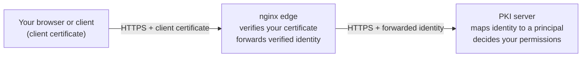

# Accessing the platform

ZeroEcho does not use passwords, one-time codes, or bearer tokens for interactive
access. You authenticate by **presenting an X.509 client certificate over mutual
TLS (mTLS)**. Your certificate *is* your identity, and the realm decides what you
can do from that identity alone.

## Mutual TLS in one picture

When you open the web console, your browser presents a client certificate to the
edge, which verifies it and forwards your verified identity to the PKI server. The
server independently re-validates that identity before mapping it to a principal
it knows.

!!! important "No password, token, or anonymous login"
    There is no login form and no API key. If your browser or client does not
    present a certificate the realm trusts, the console will not load and API
    calls are rejected. Access is refused rather than downgraded.

## What you need

- A **client certificate and its private key**, issued (or accepted) by your realm
  administrator and installed where your client can present it:
    - **Web console:** import the certificate and key into your browser's or
      operating system's certificate store as a personal certificate. Your browser
      will prompt you to choose it when you open the console URL.
    - **Command line / automation:** keep the certificate and key as files (PEM),
      or bundled in a PKCS#12 (`.p12`) keystore, for tools such as `curl`,
      `certbot`, `acme.sh`, or [`zeroecho pki`](command-line.md).
- The **console URL** and, for API or ACME use, the relevant **base URL**, both
  provided by your administrator.

!!! tip "Keep your private key private"
    Your private key never leaves your device and is never sent to the server.
    Protect it as you would any credential. If it is lost or exposed, ask an
    administrator to revoke the corresponding certificate.

## How access maps to what you can do

Authentication (proving who you are) and authorization (what you may do) are
separate steps. Presenting a valid certificate gets you *in*; your granted
permissions decide what you *see*.

The console asks the server which operations your identity may perform and renders
only those. The same is true of the API: an operation your identity is not
permitted to invoke is refused, regardless of how the request is formed.

| If your identity is granted… | You can typically… |
|---|---|
| Request submission | Submit CSRs and track your own requests. |
| Credential read access | Inspect and download your issued certificates and their chains. |
| Revocation | Request revocation of a credential you are permitted to manage. |
| Read-only relying-party access | Inspect and download published certificates and status information. |

If you expect to see an action and it is absent, your identity has most likely not
been granted it. Ask a realm administrator to review your permissions.

## Dashboard metrics

The dashboard displays current server measurements and, after you select a
**Metrics authority**, authority inventory, certificate lifecycle, revocation and
publication measurements for that CA. Available panels load once; use each
panel's **Refresh** button to request a new snapshot. There is no background
polling or historical time series. Each panel shows its computation time when
the server provides it.

Panels follow the operations available to your identity and deployment. The
server authorizes every request. Unavailable measurements, collection failures,
request failures and denied access remain explicit; missing values never become
zero. Changing the selected CA clears the previous CA's measurements.

Bars compare reported counts within each group, not percentages. Certificate
expiration windows are cumulative and overlap. A partial-count warning means
the server reached its scan limit and the displayed counts are lower bounds.
Missing CRL measurements remain unavailable until the server reports them.

## Trying it without a certificate: demo mode

To let you evaluate the console *before* you have a client certificate, the web
console ships with a self-contained **demo (review) mode**. It runs entirely in
your browser against built-in sample data — it does **not** connect to a real PKI
server, issue real certificates, or change any real state.

In demo mode you switch between **role personas** to see how the console adapts to
different identities. Each persona mirrors how the real server filters the
available operations for a principal:

| Persona | What it represents |
|---|---|
| **Administrator** | Full realm administration (all operations). |
| **Operator** | Day-to-day issuance, lifecycle, revocation, status, and publication. |
| **Issuer** | Submitting requests and issuing/inspecting credentials. |
| **Auditor** | Read-only visibility, including the audit trail. |
| **Ordinary user** | A non-privileged user: submit and inspect your own requests, and inspect credentials. |

!!! note "Demo mode is for evaluation only"
    As an ordinary, non-administrative user, the **Ordinary user** persona best
    reflects what you will experience once you have a real certificate. Because
    demo mode never contacts a server, nothing you do in it is real: no request is
    submitted and no certificate is issued. Switch to a real, mTLS-authenticated
    session (above) to do real work.

## Next steps

- Ready to request a certificate? See
  [Requesting certificates](requesting-certificates.md).
- Need an existing certificate or its chain? See
  [Managing certificates](managing-certificates.md).
- Automating enrolment? See [ACME enrolment](acme-enrollment.md) or the
  [command line](command-line.md).
