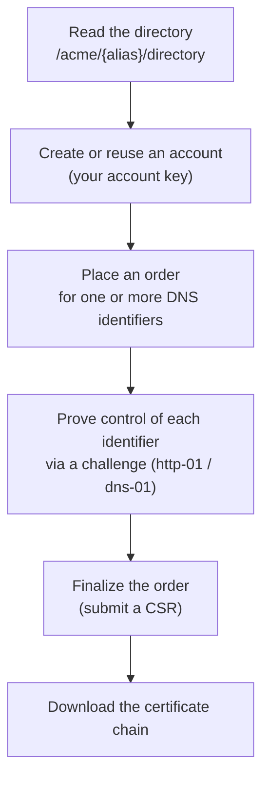

# Automatic enrolment with ACME

ZeroEcho can issue and renew certificates automatically through **ACME**, the same
protocol that public certificate authorities use. If your realm exposes an ACME
directory, you can obtain certificates with a standard, unmodified ACME client such
as [`certbot`](https://certbot.eff.org/) or
[`acme.sh`](https://github.com/acmesh-official/acme.sh) — no ZeroEcho-specific
tooling required.

This page describes the flow at a high level. Your ACME client handles the
protocol details; you mainly need the **directory URL** and, in some realms, an
**external account binding** credential.

## The directory URL

Every ACME client starts from a *directory URL* that advertises the protocol
endpoints. In ZeroEcho each ACME configuration is exposed under an **alias**, and
the directory URL always has this shape:

```
https://<host>/acme/{alias}/directory
```

For example, `https://pki.example.com/acme/servers/directory`. Your administrator
tells you the host and the `{alias}` to use. Fetching the directory shows the
endpoints the client will use:

```bash
curl -sSf https://pki.example.com/acme/servers/directory
```

```json
{
  "newNonce":   "https://pki.example.com/acme/servers/new-nonce",
  "newAccount": "https://pki.example.com/acme/servers/new-account",
  "newOrder":   "https://pki.example.com/acme/servers/new-order",
  "revokeCert": "https://pki.example.com/acme/servers/revoke-cert",
  "keyChange":  "https://pki.example.com/acme/servers/key-change"
}
```

You never need to call these by hand — point your client at the `…/directory` URL
and it discovers the rest.

## How the flow works

An ACME enrolment moves through a small number of steps. Your client performs all
of them automatically:



1. **Account.** The client registers an ACME account, identified by an account key
   it generates and keeps. Later requests are signed with that key.
2. **Order.** The client places an order listing the DNS names you want certified.
3. **Challenges.** For each name, the realm issues a challenge the client must
   satisfy to prove control. ZeroEcho supports the standard **`http-01`** and
   **`dns-01`** challenge types; which are offered is set per directory.
4. **Finalize.** Once challenges are validated, the client submits a CSR and the
   realm issues the certificate.
5. **Download.** The client downloads the issued certificate together with its
   chain, in PEM.

!!! note "Renewal is just the same flow again"
    ACME clients re-run this flow automatically before a certificate expires, so
    renewal is hands-off once enrolment works.

## Example: certbot

```bash
certbot certonly \
  --server https://pki.example.com/acme/servers/directory \
  --standalone \
  -d service.example.com \
  --agree-tos -m you@example.com
```

`--standalone` lets certbot answer an `http-01` challenge itself; use
`--webroot`, a DNS plugin (for `dns-01`), or your platform's integration as
appropriate.

## Example: acme.sh

```bash
acme.sh --issue \
  --server https://pki.example.com/acme/servers/directory \
  -d service.example.com \
  --standalone
```

## When external account binding (EAB) applies

Some realms require every new ACME account to be tied to an identity the
administrator has pre-registered. This is **external account binding (EAB)**. When
a directory requires EAB, account creation must include EAB credentials — a **key
identifier** and an **HMAC key** — that your administrator gives you. Without them,
account registration is rejected.

You supply EAB credentials to your client at registration time:

=== "certbot"

    ```bash
    certbot register \
      --server https://pki.example.com/acme/servers/directory \
      --eab-kid <key-identifier> \
      --eab-hmac-key <hmac-key> \
      --agree-tos -m you@example.com
    ```

=== "acme.sh"

    ```bash
    acme.sh --register-account \
      --server https://pki.example.com/acme/servers/directory \
      --eab-kid <key-identifier> \
      --eab-hmac-key <hmac-key>
    ```

!!! info "Whether EAB is required is set by the realm"
    If your directory does not require EAB, omit these options and register
    normally. If it does, registration without valid EAB credentials fails — ask
    your administrator for a key identifier and HMAC key.

## Transport and identity

Whether the ACME endpoint is reachable directly or through an edge that terminates
TLS, connections are made over HTTPS, and your realm may require client-certificate
transport in front of the ACME listener. Your ACME **account key** authenticates
you within the protocol; any transport client certificate is a separate,
realm-configured requirement. Your administrator will tell you if a transport
certificate is needed and provide it.

## Revoking an ACME-issued certificate

ACME clients can revoke a certificate they hold through the same directory (the
`revokeCert` endpoint), signing the request with the account or certificate key.
For example:

```bash
certbot revoke \
  --server https://pki.example.com/acme/servers/directory \
  --cert-path /etc/letsencrypt/live/service.example.com/cert.pem
```

You can also check any issued certificate's status through the
[public repository](managing-certificates.md#understand-validity-and-revocation-status).

## Next steps

- Prefer to drive requests yourself? [Requesting certificates](requesting-certificates.md).
- Need to inspect or download an issued certificate? [Managing certificates](managing-certificates.md).
