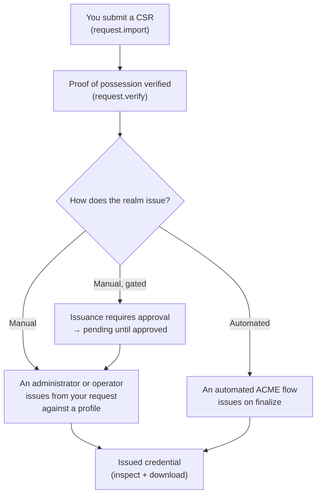

# Requesting certificates

A certification request tells the realm *what* you want certified and proves that
you hold the private key for the public key you are asking it to sign. This page
walks through preparing a request, submitting it, having its proof of possession
verified, and understanding what happens next.

The three request operations you will use are:

| Operation | Purpose |
|---|---|
| `request.import` | Submit a DER-encoded CSR to the realm. |
| `request.verify` | Confirm the request's signature and proof of possession. |
| `request.inspect` | Look up a submitted request by its identifier. |

## Step 1 — Prepare a key and a CSR

A CSR (Certificate Signing Request, PKCS#10) bundles your public key and requested
subject details, self-signed with your private key. The self-signature is the
**proof of possession**: it demonstrates you hold the private key without ever
revealing it.

You can create a key pair and a CSR with common tooling. Two examples:

=== "openssl (one step)"

    ```bash
    # Generate a 3072-bit RSA key and a CSR in one command.
    openssl req -new \
      -newkey rsa:3072 -nodes -keyout example.key \
      -out example.csr \
      -subj "/CN=service.example.com/O=Example Org"
    ```

=== "openssl (existing key)"

    ```bash
    # If you already hold a private key, build a CSR from it.
    openssl req -new \
      -key example.key \
      -out example.csr \
      -subj "/CN=service.example.com/O=Example Org"
    ```

=== "Elliptic curve key"

    ```bash
    # Generate an EC P-256 key, then a CSR.
    openssl ecparam -name prime256v1 -genkey -noout -out example.key
    openssl req -new -key example.key -out example.csr \
      -subj "/CN=service.example.com/O=Example Org"
    ```

Inspect the CSR before you submit it, so you know exactly what you are asking for:

```bash
openssl req -in example.csr -noout -text -verify
```

The `-verify` flag checks the CSR's own signature locally — a first, offline
confirmation that the proof of possession is sound.

!!! tip "The subject and extensions you request are only a *request*"
    The realm issues according to a certificate **profile** chosen by an
    administrator. The profile may constrain, override, or drop fields you asked
    for (for example, key usages or SANs). Requesting a field does not guarantee
    it will appear in the issued certificate.

## Step 2 — Submit the request

Submission takes the DER form of the CSR. Convert your PEM CSR to DER, then submit
it. The realm assigns your request an identifier — **keep it**, you will use it to
track and act on the request.

=== "Command line"

    ```bash
    # Convert the PEM CSR to DER first.
    openssl req -in example.csr -outform DER -out example.der

    # Submit it over mutual TLS. request.import takes the format id and the
    # base64-encoded DER CSR; the CLI reads the file and encodes it for you.
    zeroecho pki request.import \
      --url https://pki.example.com:8443 \
      --client-keystore me.p12 --client-keystore-password-env PKI_P12_PASSWORD \
      --format-id x509 \
      --encoding DER --request-file example.der \
      --output json
    ```

    The response carries the new **request identifier**. Record it. See
    [Command line](command-line.md) for connection and output details.

=== "Web console"

    1. Open the console (you will be prompted for your client certificate).
    2. Go to **Requests** and choose **Import request (CSR)**.
    3. Provide the format id (typically `x509`) and upload or paste the
       base64-encoded DER CSR.
    4. Submit. The console shows the assigned **request identifier** — note it for
       the next steps.

!!! note "Only your private key signs the CSR"
    You submit the CSR — never your private key. The key stays on your machine.

## Step 3 — Verify proof of possession

Verification re-checks the request's signature on the server side, confirming the
CSR is well-formed and that its proof of possession holds.

=== "Command line"

    ```bash
    zeroecho pki request.verify \
      --url https://pki.example.com:8443 \
      --client-keystore me.p12 --client-keystore-password-env PKI_P12_PASSWORD \
      --request-id <request-id> \
      --output json
    ```

=== "Web console"

    Open the request from the **Requests** list and choose **Verify request**. The
    console reports whether the proof of possession is valid.

A request that fails verification will not be issued. Correct the CSR (for
example, regenerate it against the intended key) and submit again.

## Step 4 — What happens next

Once a request is submitted and verified, issuance is a **separate** step, and it
is not something you perform yourself as an ordinary requester. There are two
common paths:



- **Issuance by an administrator or operator.** A privileged user issues a
  credential from your verified request against a specific profile. You then
  retrieve the credential — see [Managing certificates](managing-certificates.md).
- **Issuance through an automated flow.** If your realm exposes ACME, enrolment
  and issuance happen automatically end to end; you do not import a CSR by hand at
  all. See [ACME enrolment](acme-enrollment.md).

### Where issuance approval applies

Some realms require an **approval** before a credential is issued — for example,
when a profile is configured to gate issuance, or for higher-risk operations. When
that applies:

- The issuance does not complete immediately; it becomes **pending** until a
  privileged user (or the required number of approvers) approves it.
- From a scripted client this surfaces as a *"outcome not yet known / resume
  later"* result rather than a failure. See
  [that result explained](command-line.md#outcome-not-yet-known).

!!! info "You track; administrators issue and approve"
    As a requester you can submit, verify, and inspect your request, and later
    retrieve the resulting credential. Issuing and approving are administrative
    actions. If a request stays un-issued longer than you expect, ask a realm
    administrator about its issuance or approval status.

## Track a request at any time

Use the request identifier to check on a request:

=== "Command line"

    ```bash
    zeroecho pki request.inspect \
      --url https://pki.example.com:8443 \
      --client-keystore me.p12 --client-keystore-password-env PKI_P12_PASSWORD \
      --request-id <request-id> \
      --output json
    ```

=== "Web console"

    Open **Requests**, then select your request to see its current state and
    details.

## Next steps

- Retrieve and inspect the issued certificate:
  [Managing certificates](managing-certificates.md).
- Prefer hands-off issuance and renewal? [ACME enrolment](acme-enrollment.md).
